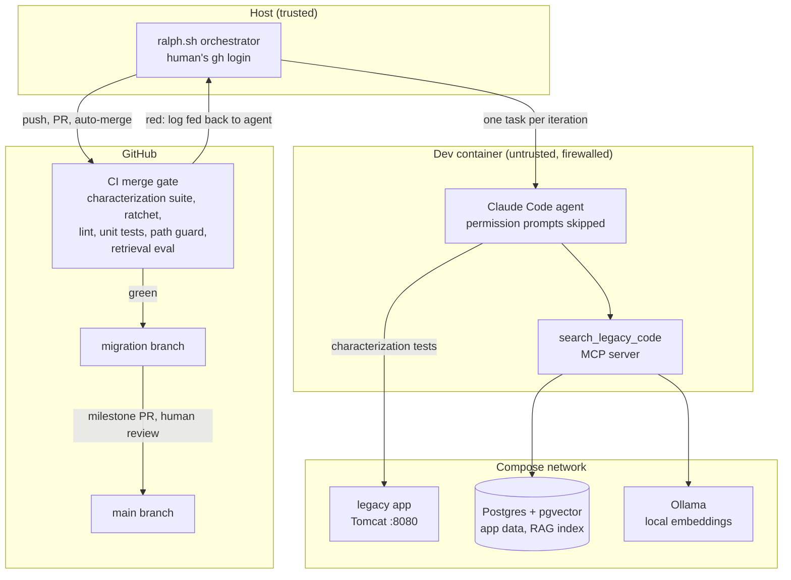

# legacy-modernization-agent

[](https://github.com/flamewave99/legacy-modernization-agent/actions/workflows/ci.yml)

AI coding agents migrated a legacy Java web app to TypeScript. A characterization test suite is the gate, the plan comes from a spec the agents derived from the code, and an unattended loop opened one CI-gated pull request per task. The migration is complete ([run and verify it yourself](#run-and-verify-it)): the modern app passes all 60 characterization tests that pin the legacy app's behavior, and the legacy defects found along the way are written up in [`FINDINGS.md`](FINDINGS.md).

- **From:** [Spring Framework PetClinic](https://github.com/spring-petclinic/spring-framework-petclinic): Spring MVC, JSP, XML config, JPA on Tomcat.
- **To:** React + Vite, Fastify, Postgres, with the same routes and behavior.

<p align="center"></p>

## The idea in brief

Rewriting a legacy app is risky because nobody can say exactly what the old app does, quirks included. This project makes that question testable, then lets an AI agent do the rewrite under a gate it cannot weaken:

1. **Pin the behavior first.** A Playwright suite of 60 *characterization tests* records what the legacy app does today, judged from the outside (visible text, form field names, URLs, status codes), so the same suite can judge any rewrite.
2. **Derive a spec and a plan from the code.** Subagents analyzed the legacy code; every claim was checked against the running app; the result is [`SPEC.md`](SPEC.md) and 25 small ordered tasks in [`fix_plan.md`](fix_plan.md).
3. **Let an agent work in a loop.** A *Ralph loop* runs Claude Code headless with the same prompt over and over; each iteration picks the next unticked task, implements it with tests, and commits. State lives in files (the plan, `NOTES.md`), not in a conversation.
4. **Make safety structural.** The agent runs in a firewalled sandbox with no GitHub credentials. A host script turns each iteration into a pull request, and GitHub merges it only when CI is green. A *ratchet* list makes sure a test that passes against the new app can never stop passing.
5. **Measure everything.** Behavior parity per spec file, a retrieval eval for the RAG search over the legacy code (with a held-out set), and a write-up of every legacy defect found.

**Contents:** [Results](#results) · [Legacy defects found](#legacy-defects-found) · [Architecture](#architecture) · [How it works](#how-it-works) · [Guardrails](#guardrails) · [Lessons](#lessons-from-the-evals-and-tests) · [Run and verify it](#run-and-verify-it) · [Where to look](#where-to-look) · [Layout](#layout)

## Results

Final numbers, 2026-10-12. Per-spec parity is in [`docs/PARITY.md`](docs/PARITY.md); every task is a [pull request](https://github.com/flamewave99/legacy-modernization-agent/pulls?q=is%3Apr+head%3Aralph).

| | |
|---|---|
| Legacy behavior pinned | **60** Playwright characterization tests (plus 6 for known legacy bugs), all passing against legacy in CI |
| Rewrite | **25 / 25** plan tasks done by the loop, 24 of them as their own CI-gated PR (task 2 was done during setup). Median time from PR opened to merged: **1.9 minutes**. The 12 web and finishing tasks (14–25) took about 1 h 40 min of unattended loop time. |
| Behavior parity | **60 / 60** characterization tests pass against the modern app, in CI (the ratchet) and against the production container (`docker compose up modern`). |
| Unit tests | 274 API and 36 web tests (Vitest), plus 13 for `rag/` and 5 for `mcp/` |
| Legacy defects | 11 documented in the spec (SPEC §8), each with its root cause at file:line ([`FINDINGS.md`](FINDINGS.md)). 7 are fixed in modern; 1 is kept for parity, the others are out of scope by decision. |
| Retrieval (RAG) | Right file in the top 5 for **19/22** development questions (vector) and **21/22** (hybrid BM25 + vector). Held-out set: 12/12 and 11/12. Deterministic across 17 CI runs, so CI now gates on it. [Details](rag/README.md#eval-phase-6). |
| Guardrails | Every safety path tested on purpose, live on GitHub: a failing CI run, a merge conflict, an agent editing a protected test, a direct push to a protected branch, and (offline) a usage-limit cut-off. |

## Legacy defects found

Writing the spec and the tests surfaced 11 defects in the legacy app. The decision was to fix them rather than copy them; six `@legacy-bug` tests pin the legacy behavior, so the difference is visible (they pass on legacy and fail on modern by design). Root causes at file:line, fixes and tests: [`FINDINGS.md`](FINDINGS.md).

| | Legacy behavior | Modern |
|---|---|---|
| D1 | A blank visit date is saved; the owner page then crashes (500) once that pet has a second visit | Fixed: the date is required |
| D2 | A rejected owner edit re-renders as "New Owner" / "Add Owner" | Fixed: stays "Owner" / "Update Owner" |
| D3 | The visits list route points to a view that does not exist (404) | Same 404, by design |
| D4 | Editing a pet that does not exist is a raw 500 with a stack trace | Fixed: the friendly error page |
| D5 | An unknown pet type leaks a Java conversion error, unescaped | Fixed: `invalid value` |
| D6 | Error messages are written as raw HTML (an XSS path) | Fixed: React escapes all text |
| D7 | Pet edit trusts a hidden form id, so a request can overwrite any pet and move it to another owner | Fixed: only the URL's ids count |
| D8 | Pet and visit pages do not check that the pet belongs to the owner in the URL | Kept for parity |
| D9 | An empty telephone shows one of two error messages at random | Fixed: always `must not be empty` |
| D10 | German messages are garbled (the UTF-8 message file is read as ISO-8859-1) | Not applicable: i18n not ported |
| D11 | Years with more than 4 digits are accepted | Accepted divergence: 4 digits only |

## Architecture



The agent only edits files and makes local commits. Everything that touches GitHub happens on the host.

## How it works

| # | Phase | What happened |
|---|---|---|
| 1 | **Pin the legacy behavior** | A Playwright suite records what the legacy app does today, quirks included. It finds elements by visible text and form field names, never by JSP structure, so the same suite can judge a React app. `BASE_URL` points it at either app. |
| 2 | **Spec from code** | Four subagents analyzed routes, domain/schema, views and validation in parallel. Their claims were checked against the running app (several were wrong) and merged into [`SPEC.md`](SPEC.md) and an ordered [`fix_plan.md`](fix_plan.md). |
| 3 | **Ralph loop** | [`ralph.sh`](ralph.sh) runs Claude Code headless with [`PROMPT.md`](PROMPT.md), one task per iteration. The agent works in a sandbox. The orchestrator turns each iteration into a PR that GitHub merges only when CI is green. CI failures and merge conflicts go back to the agent to fix. |
| 4 | **RAG over legacy code** | Java split per method, JSP and XML whole or windowed, embedded locally (`nomic-embed-text` via Ollama) into pgvector. CLIs to `search` and to `ask` with cited answers. |
| 5 | **MCP server** | [`mcp/`](mcp/) exposes `search_legacy_code` to Claude Code. The loop's agent had it in every iteration, but mostly chose grep and probing the running legacy app instead (see below). |
| 6 | **Evals** | A retrieval eval with development and held-out question sets compares keyword, vector and hybrid search across two models, and gates CI against a baseline. A parity report tracks characterization tests on legacy vs. modern. |
| 7 | **Findings** | With every task done, the `@legacy-bug` tests were run against modern and each legacy defect was traced to its root cause in [`FINDINGS.md`](FINDINGS.md). The production container was verified on the host. |

## Guardrails

The agent runs unattended with permission prompts skipped, so safety comes from architecture, not instructions.

| Risk | Control | Enforced by |
|---|---|---|
| Agent pushes or merges bad code | The agent has **no GitHub credentials** and no route to GitHub. Only the host orchestrator pushes, and only `ralph/*` branches | Sandbox firewall, credential separation |
| A broken change lands | Branch protection on `migration` and `main` requires the CI gate, even for admins. Auto-merge happens only when it is green | GitHub |
| Agent weakens the tests or the gate | Protected paths (tests, CI, sandbox, prompts, `legacy/`, `rag/`, `mcp/`) stop the loop locally and fail CI. The orchestrator's token has no `workflow` scope | Orchestrator, CI, GitHub token scopes |
| Agent breaks what already works | The **ratchet** (`modern/ratchet.txt`): characterization tests that pass against modern must keep passing, and the list can only grow | CI |
| Agent escapes the sandbox | No Docker socket, non-root user, default-deny outbound firewall, read-only `.git/config` and hooks, prompt and MCP config read from `origin` | Dev container, orchestrator |
| Agent reaches personal data | Runs with `--strict-mcp-config`: only the project MCP server, none of the human's account connectors | Orchestrator |
| Human merges unreviewed work to `main` | The orchestrator opens a milestone PR when a plan section completes. A human reviews and merges it | Process |

## Lessons from the evals and tests

Selected from [`NOTES.md`](NOTES.md), which records every decision and surprise, numbered.

- **Characterization tests caught wrong analysis.** Subagents and I made confident claims that the running app contradicted: a "deterministic" validation message is random per request; a "bug" in the date picker isn't one. The suite, not the analysis, is the source of truth.
- **Keyword search needs IDF.** Hybrid search built on Postgres `ts_rank` was *worse* than vectors alone. BM25 made it the best configuration on the development set.
- **A bigger embedding model was worse** on this codebase. Only measuring shows that.
- **Held-out data changed the decision.** Hybrid won the development set but not clearly the held-out set, so it ships as a flag (`RAG_STRATEGY=hybrid`) with the default unchanged.
- **CI design shapes agent throughput.** Running all 60 tests against a half-built app made each PR wait 12 minutes. Enforcing only the ratchet in CI, with the agent finding newly passing tests locally, cut that to about 1.5 minutes.
- **End-to-end tests find what unit tests can't.** Claude Code passes a tool's `structuredContent`, not its text, to the model. Only running the agent through the MCP tool showed it was getting file names without code.
- **Parallel work collides.** Human PRs and agent PRs kept appending to the same log file. The orchestrator now merges `migration` in before every push and hands real conflicts to the agent, which resolves them (see the animation above).
- **The agent preferred grep and the running app to RAG.** Over 30 iterations it called `search_legacy_code` 3 times, against 36 shell reads of `legacy/` and 18 requests to the legacy app. With a shell, ~100 source files and class names that match the domain (`OwnerController`, `PetValidator`), exact search and probing the real behavior won. RAG earns its place for people asking conceptual questions and for codebases too large to grep (NOTES N75).
- **Probing beats reading for behavior.** The hardest parity details (which ids Spring accepts, which Unicode digits count in a phone number, Jackson's property order) were settled by sending requests to the running legacy app, not by reading its code (NOTES N49, N52, N56).
- **A test run can lie.** Several times a server left over from an earlier iteration still held port 3000, so the suite tested old code. The agent learned to check the port's owner before trusting a run (NOTES N56, N69).
- **Load finds races.** A redirect race passed locally and failed only under CI's load; a 12-worker stress run reproduced it before the fix (NOTES N68).
- **Review applies to human code too.** A code review of the first milestone found 10 issues: 9 in code I wrote, 1 in the agent's.

## Run and verify it

Requirements: Docker with Compose, Node 24, Playwright's Chromium dependencies (`npx playwright install-deps chromium`, once), and free ports 8080, 3000, 5433 and 11434. Claude Code only for the MCP step. About 15 minutes from a fresh clone; [`docs/WALKTHROUGH.md`](docs/WALKTHROUGH.md) has the same steps with more explanation.

**1. Start both apps.** Legacy (Spring, JSP, Tomcat) on http://localhost:8080, modern (React, Fastify) on http://localhost:3000, sharing Postgres. The modern container seeds an empty database on first start.

```bash
docker compose up -d --build legacy db modern
docker compose ps                            # legacy, db and modern Up; db and modern (healthy)
```

Open both and do the same things in each: Find owners → "Davis" (a list of two) → "Franklin" (one match, straight to the owner) → Add New Pet → Add Visit → Veterinarians → Error. Pages, messages and URLs match.

**2. Behavior parity: the same 60 tests against both apps.**

```bash
cd tests/characterization
npm install && npx playwright install chromium
npm test                                     # 60 passed (legacy, the default)
BASE_URL=http://localhost:3000 npm test      # 60 passed (modern)
```

**3. Legacy defects: where modern differs on purpose.**

```bash
INCLUDE_LEGACY_BUGS=1 npx playwright test specs/legacy-bugs.spec.ts                                  # legacy: 6 passed
INCLUDE_LEGACY_BUGS=1 BASE_URL=http://localhost:3000 npx playwright test specs/legacy-bugs.spec.ts   # modern: 5 failed, 1 passed (expected)
cd ../..
```

**4. Modern app: lint, build and unit tests.**

```bash
npm install
npm run lint && npm run build && npm test    # API 274 passed, web 36 passed
```

To run from source instead of the container: `docker compose stop modern`, then `npm run db:reset -w modern/api && npm run start -w modern/api`.

**5. RAG over the legacy code, and the eval that gates CI.**

```bash
docker compose up -d ollama && docker compose exec ollama ollama pull nomic-embed-text
cd rag && npm install
npm run index                                # ~1.5 min on CPU: 102 files -> 325 chunks
npm run search -- "how are duplicate pet names rejected?"   # Owner#getPet, PetController#processCreationForm
npm run eval -- --check keyword:bm25 vector:nomic-embed-text hybrid-bm25:nomic-embed-text   # "same:" for each
npm run eval -- --holdout --check vector:nomic-embed-text hybrid-bm25:nomic-embed-text
git checkout eval/ && cd ..                  # the eval rewrites eval/RESULTS*.md with only the strategies run
```

**6. The MCP server** (Claude Code): `cd mcp && npm install && cd .. && claude mcp list` shows `legacy-code: ✔ Connected`. Then ask Claude Code to "use search_legacy_code to find how duplicate pet names are rejected".

**7. The orchestrator, offline.** `scripts/ralph-selftest.sh` runs the real `ralph.sh` against a throwaway clone with a scripted agent (no GitHub, no model) and prints `PASS: usage-limit handling`.

**The loop itself.** The migration is finished (`DONE` exists), so `./ralph.sh` stops at once. Each real iteration is a [pull request from a `ralph/*` branch](https://github.com/flamewave99/legacy-modernization-agent/pulls?q=is%3Apr+head%3Aralph) with its CI run, and the animation at the top replays one. To run it for a new plan: `npx @devcontainers/cli up --workspace-folder .`, log in once with `npx @devcontainers/cli exec --workspace-folder . claude`, then `./ralph.sh` on the host.

**Clean up:** `docker compose down` (add `-v` to delete the database and model volumes).

## Where to look

| Look at | What it shows |
|---|---|
| [`tests/characterization/specs/owners.spec.ts`](tests/characterization/specs/owners.spec.ts) | Characterization tests: behavior pinned from the outside, so one test judges both implementations |
| [`modern/ratchet.txt`](modern/ratchet.txt), [`.github/workflows/ci.yml`](.github/workflows/ci.yml) | The ratchet (a passing test can never stop passing) and the path guard that stops agent branches touching tests, CI or prompts |
| [`SPEC.md`](SPEC.md), [`fix_plan.md`](fix_plan.md) | The spec derived from the code and checked against the running app; 25 tasks, each one loop iteration |
| [`ralph.sh`](ralph.sh), [`PROMPT.md`](PROMPT.md), [`.devcontainer/`](.devcontainer/) | The loop and the trust boundary: CI failures and merge conflicts fed back to the agent, usage limits waited out, a sandbox with no credentials |
| [`FINDINGS.md`](FINDINGS.md) D1, D7, D9 | Legacy defects traced to root cause: a crash only on the second visit, a hidden form id that lets a request overwrite any pet, a validation message that is random per request |
| [`NOTES.md`](NOTES.md) N49, N52, N56 | Parity details found by probing the running legacy app: which ids Spring accepts, which Unicode digits count, Jackson's property order |
| [`NOTES.md`](NOTES.md) N38, N68, N69 | What went wrong and how it was fixed: conflicts between human and agent PRs, a race only visible under CI load, a stale server that made test runs lie |
| [`rag/README.md`](rag/README.md), [`NOTES.md`](NOTES.md) N46, N75, N76 | Measuring retrieval: BM25 vs `ts_rank`, development vs held-out sets, report-only until proven deterministic, then a gate; and why the agent preferred grep |
| [`modern/api/src/routes/pages.ts`](modern/api/src/routes/pages.ts) | How a single-page app keeps legacy's HTTP statuses: the server decides 200, 400 or 404 per route before React loads |

## Layout

| Path | What |
|---|---|
| `legacy/` | Vendored upstream app (Apache 2.0), unmodified |
| `tests/characterization/` | Behavior tests: the source of truth for both apps |
| `SPEC.md`, `fix_plan.md` | Behavior spec derived from the legacy code; ordered task list |
| `modern/` | The rewrite (built by the loop): `api/` (Fastify), `web/` (React), `Dockerfile`; `modern/ratchet.txt` lists the passing tests |
| `FINDINGS.md` | Legacy defects: behavior, root cause at file:line, the modern fix, and the test that shows it |
| `ralph.sh`, `PROMPT.md`, `CLAUDE.md` | Orchestrator, per-iteration prompt, agent rules |
| `.devcontainer/` | Agent sandbox: firewall, no Docker socket, read-only git config |
| `.github/workflows/ci.yml` | Merge gate, including the retrieval eval against its baseline |
| `rag/`, `mcp/` | Retrieval over legacy code and its MCP server; `rag/eval/` holds the question sets and results |
| `docs/` | Walkthrough (run, verify, guided tour), parity report, loop animation |
| `scripts/` | `parity-report.mjs`, `log-to-svg.mjs`, `agent-tool-usage.mjs`, `ralph-selftest.sh` |
| `NOTES.md` | Every decision and surprise, numbered |

## License

MIT (see `LICENSE`). The vendored PetClinic code in `legacy/` remains Apache 2.0 (see `legacy/LICENSE.txt`).
