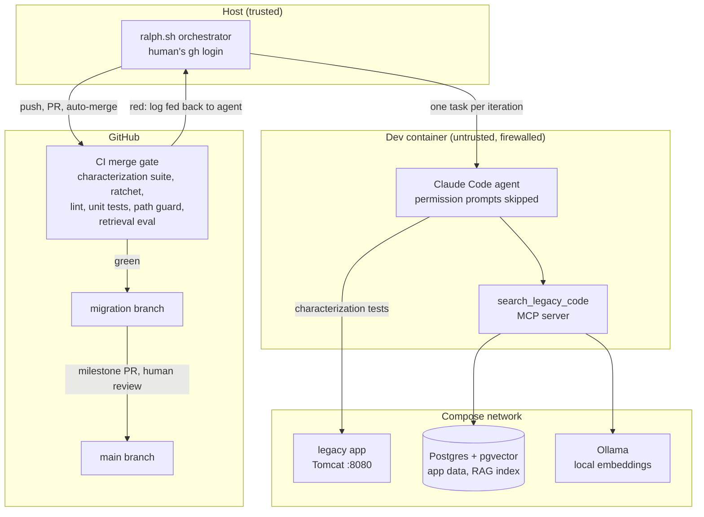

# legacy-modernization-agent

[](https://github.com/flamewave99/legacy-modernization-agent/actions/workflows/ci.yml)

AI coding agents migrated a legacy Java web app to TypeScript. A characterization test suite is the gate, the plan comes from a spec the agents derived from the code, and an unattended loop opened one CI-gated pull request per task. The migration is complete: the modern app passes all 60 characterization tests that pin the legacy app's behavior, and the legacy defects found along the way are written up in [`FINDINGS.md`](FINDINGS.md).

- **From:** [Spring Framework PetClinic](https://github.com/spring-petclinic/spring-framework-petclinic): Spring MVC, JSP, XML config, JPA on Tomcat.
- **To:** React + Vite, Fastify, Postgres, with the same routes and behavior.

<p align="center"></p>

## Results

Final numbers, 2026-10-12. Per-spec parity is in [`docs/PARITY.md`](docs/PARITY.md); every task is a [pull request](https://github.com/flamewave99/legacy-modernization-agent/pulls?q=is%3Apr+head%3Aralph).

| | |
|---|---|
| Legacy behavior pinned | **60** Playwright characterization tests (plus 6 for known legacy bugs), all passing against legacy in CI |
| Rewrite | **25 / 25** plan tasks done by the loop, 24 of them as their own CI-gated PR (task 2 was done during setup). Median time from PR opened to merged: **1.9 minutes**. The 12 web and finishing tasks (14–25) took about 1 h 40 min of unattended loop time. |
| Behavior parity | **60 / 60** characterization tests pass against the modern app, in CI (the ratchet) and against the production container (`docker compose up modern`). |
| Unit tests | 274 API and 36 web tests (Vitest), plus 13 for `rag/` and 5 for `mcp/` |
| Legacy defects | 11 documented in the spec (SPEC §8), each with its root cause at file:line ([`FINDINGS.md`](FINDINGS.md)). 7 are fixed in modern; 1 is kept for parity, the others are out of scope by decision. |
| Retrieval (RAG) | Right file in the top 5 for **19/22** development questions (vector) and **21/22** (hybrid BM25 + vector). Held-out set: 12/12 and 11/12. Deterministic across 17 CI runs, so CI now gates on it. [Details](rag/README.md#eval-phase-6). |
| Guardrails | Every safety path tested on purpose, live on GitHub: a failing CI run, a merge conflict, an agent editing a protected test, a direct push to a protected branch, and (offline) a usage-limit cut-off. |

## Architecture



The agent only edits files and makes local commits. Everything that touches GitHub happens on the host.

## How it works

| # | Phase | What happened |
|---|---|---|
| 1 | **Pin the legacy behavior** | A Playwright suite records what the legacy app does today, quirks included. It finds elements by visible text and form field names, never by JSP structure, so the same suite can judge a React app. `BASE_URL` points it at either app. |
| 2 | **Spec from code** | Four subagents analyzed routes, domain/schema, views and validation in parallel. Their claims were checked against the running app (several were wrong) and merged into [`SPEC.md`](SPEC.md) and an ordered [`fix_plan.md`](fix_plan.md). |
| 3 | **Ralph loop** | [`ralph.sh`](ralph.sh) runs Claude Code headless with [`PROMPT.md`](PROMPT.md), one task per iteration. The agent works in a sandbox. The orchestrator turns each iteration into a PR that GitHub merges only when CI is green. CI failures and merge conflicts go back to the agent to fix. |
| 4 | **RAG over legacy code** | Java split per method, JSP and XML whole or windowed, embedded locally (`nomic-embed-text` via Ollama) into pgvector. CLIs to `search` and to `ask` with cited answers. |
| 5 | **MCP server** | [`mcp/`](mcp/) exposes `search_legacy_code` to Claude Code. The loop's agent had it in every iteration, but mostly chose grep and probing the running legacy app instead (see below). |
| 6 | **Evals** | A retrieval eval with development and held-out question sets compares keyword, vector and hybrid search across two models, and gates CI against a baseline. A parity report tracks characterization tests on legacy vs. modern. |
| 7 | **Findings** | With every task done, the `@legacy-bug` tests were run against modern and each legacy defect was traced to its root cause in [`FINDINGS.md`](FINDINGS.md). The production container was verified on the host. |

## Guardrails

The agent runs unattended with permission prompts skipped, so safety comes from architecture, not instructions.

| Risk | Control | Enforced by |
|---|---|---|
| Agent pushes or merges bad code | The agent has **no GitHub credentials** and no route to GitHub. Only the host orchestrator pushes, and only `ralph/*` branches | Sandbox firewall, credential separation |
| A broken change lands | Branch protection on `migration` and `main` requires the CI gate, even for admins. Auto-merge happens only when it is green | GitHub |
| Agent weakens the tests or the gate | Protected paths (tests, CI, sandbox, prompts, `legacy/`, `rag/`, `mcp/`) stop the loop locally and fail CI. The orchestrator's token has no `workflow` scope | Orchestrator, CI, GitHub token scopes |
| Agent breaks what already works | The **ratchet** (`modern/ratchet.txt`): characterization tests that pass against modern must keep passing, and the list can only grow | CI |
| Agent escapes the sandbox | No Docker socket, non-root user, default-deny outbound firewall, read-only `.git/config` and hooks, prompt and MCP config read from `origin` | Dev container, orchestrator |
| Agent reaches personal data | Runs with `--strict-mcp-config`: only the project MCP server, none of the human's account connectors | Orchestrator |
| Human merges unreviewed work to `main` | The orchestrator opens a milestone PR when a plan section completes. A human reviews and merges it | Process |

## What the evals and tests taught (selected from [`NOTES.md`](NOTES.md))

- **Characterization tests caught wrong analysis.** Subagents and I made confident claims that the running app contradicted: a "deterministic" validation message is random per request; a "bug" in the date picker isn't one. The suite, not the analysis, is the source of truth.
- **Keyword search needs IDF.** Hybrid search built on Postgres `ts_rank` was *worse* than vectors alone. BM25 made it the best configuration on the development set.
- **A bigger embedding model was worse** on this codebase. Only measuring shows that.
- **Held-out data changed the decision.** Hybrid won the development set but not clearly the held-out set, so it ships as a flag (`RAG_STRATEGY=hybrid`) with the default unchanged.
- **CI design shapes agent throughput.** Running all 60 tests against a half-built app made each PR wait 12 minutes. Enforcing only the ratchet in CI, with the agent finding newly passing tests locally, cut that to about 1.5 minutes.
- **End-to-end tests find what unit tests can't.** Claude Code passes a tool's `structuredContent`, not its text, to the model. Only running the agent through the MCP tool showed it was getting file names without code.
- **Parallel work collides.** Human PRs and agent PRs kept appending to the same log file. The orchestrator now merges `migration` in before every push and hands real conflicts to the agent, which resolves them (see the animation above).
- **The agent preferred grep and the running app to RAG.** Over 30 iterations it called `search_legacy_code` 3 times, against 36 shell reads of `legacy/` and 18 requests to the legacy app. With a shell, ~100 source files and class names that match the domain (`OwnerController`, `PetValidator`), exact search and probing the real behavior won. RAG earns its place for people asking conceptual questions and for codebases too large to grep (NOTES N75).
- **Probing beats reading for behavior.** The hardest parity details (which ids Spring accepts, which Unicode digits count in a phone number, Jackson's property order) were settled by sending requests to the running legacy app, not by reading its code (NOTES N49, N52, N56).
- **A test run can lie.** Several times a server left over from an earlier iteration still held port 3000, so the suite tested old code. The agent learned to check the port's owner before trusting a run (NOTES N56, N69).
- **Load finds races.** A redirect race passed locally and failed only under CI's load; a 12-worker stress run reproduced it before the fix (NOTES N68).
- **Review applies to human code too.** A code review of the first milestone found 10 issues: 9 in code I wrote, 1 in the agent's.

## Run it

Requirements: Docker, Node 24, and Playwright's Chromium dependencies (`npx playwright install-deps chromium`).

```bash
# Both apps: legacy on :8080, modern (production image) on :3000, sharing Postgres
docker compose up -d --build legacy db modern

# Characterization suite against each
cd tests/characterization && npm install && npx playwright install chromium
npm test                                   # 60 tests against legacy at :8080
BASE_URL=http://localhost:3000 npm test    # the same 60 against modern
INCLUDE_LEGACY_BUGS=1 npm test             # plus the 6 known-legacy-bug tests (pass on legacy only)

# Modern app from source: lint, build, unit tests, then serve the build
cd ../.. && npm install && npm run lint && npm run build && npm test
docker compose stop modern                                        # frees :3000
npm run db:reset -w modern/api && npm run start -w modern/api   # :3000

# RAG, MCP and the retrieval eval
docker compose up -d ollama && docker compose exec ollama ollama pull nomic-embed-text
cd rag && npm install && npm run index && npm run eval
npm run search -- "what happens when a search finds exactly one owner?"
cd ../mcp && npm install && claude mcp list   # legacy-code: ✔ Connected

# The Ralph loop (agent in the sandbox, orchestrator on the host)
npx @devcontainers/cli up --workspace-folder .
npx @devcontainers/cli exec --workspace-folder . claude   # first time only: log in
./ralph.sh                                                 # on the host
```

## Layout

| Path | What |
|---|---|
| `legacy/` | Vendored upstream app (Apache 2.0), unmodified |
| `tests/characterization/` | Behavior tests: the source of truth for both apps |
| `SPEC.md`, `fix_plan.md` | Behavior spec derived from the legacy code; ordered task list |
| `modern/` | The rewrite (built by the loop): `api/` (Fastify), `web/` (React), `Dockerfile`; `modern/ratchet.txt` lists the passing tests |
| `FINDINGS.md` | Legacy defects: behavior, root cause at file:line, the modern fix, and the test that shows it |
| `ralph.sh`, `PROMPT.md`, `CLAUDE.md` | Orchestrator, per-iteration prompt, agent rules |
| `.devcontainer/` | Agent sandbox: firewall, no Docker socket, read-only git config |
| `.github/workflows/ci.yml` | Merge gate, including the retrieval eval against its baseline |
| `rag/`, `mcp/` | Retrieval over legacy code and its MCP server; `rag/eval/` holds the question sets and results |
| `docs/` | Parity report, loop animation |
| `scripts/` | `parity-report.mjs`, `log-to-svg.mjs`, `agent-tool-usage.mjs`, `ralph-selftest.sh` |
| `NOTES.md` | Every decision and surprise, numbered |

## License

MIT (see `LICENSE`). The vendored PetClinic code in `legacy/` remains Apache 2.0 (see `legacy/LICENSE.txt`).
